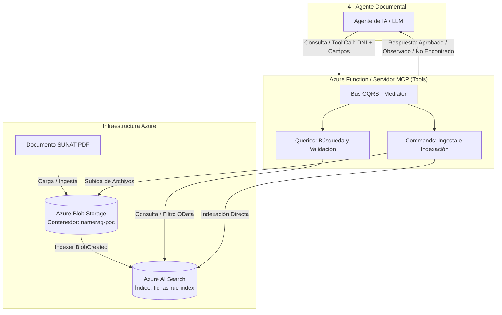

# MCP Azure Function RAG - CQRS Document Validation

Sistema de validación documental SUNAT y recuperación aumentada por generación (RAG) implementado como un **Servidor MCP (Model Context Protocol)** y **Azure Functions v2**, desacoplado mediante el patrón de arquitectura **CQRS (Command Query Responsibility Segregation)**, conectado a **Azure AI Search** y **Azure Blob Storage**.

Desarrollado para **Python 3.14** (compatible con Python >= 3.12).

---

## 📐 Arquitectura del Sistema

El proyecto implementa la arquitectura descrita en el flujo del Agente Documental:



---

## ⚡ Patrón CQRS (Command Query Responsibility Segregation)

El sistema separa estrictamente las operaciones de lectura de las operaciones de modificación de estado:

### 🔍 Queries (Lecturas y Validaciones)
- **`GetFichaRucByDniQuery`**: Consulta directa en Azure AI Search por DNI (`filter="dni eq '{dni}'"`).
- **`ValidateFichaRucQuery`**: Valida y coteja los datos proporcionados (`DNI`, `NOMBRE_PERSONA`, `NOMBRE_COMERCIAL`, `ACTIVIDAD_ECONOMICA`) contra la base de conocimientos.
  - **APROBADO**: Si todos los campos coinciden.
  - **OBSERVADO**: Si uno o varios campos difieren.
  - **NO_ENCONTRADO**: Si el DNI no existe en el índice.

### ✍️ Commands (Mutaciones e Ingesta)
- **`IndexFichaRucCommand`**: Registra o actualiza directamente un registro en el índice `fichas-ruc-index`.
- **`UploadBlobCommand`**: Carga documentos físicos (PDF/DOC) en el contenedor de Azure Blob Storage (`namerag-poc`).

### 🚌 CQRS Mediator
El bus `CQRSMediator` desacopla los controladores HTTP y las herramientas MCP de la lógica de dominio.

### 🌐 Capa Cross-Cutting (`src/crosscutting/`)
Centraliza todas las constantes transversales de la aplicación para evitar valores mágicos (*magic strings*):
- **Constantes de Negocio y Validación**: Mensajes estándar (`MSG_APROBADO`, `MSG_NO_ENCONTRADO`), plantilla de observación (`PLANTILLA_OBSERVACION`), y claves de salida JSON (`KEY_RESULTADO`, `KEY_COMENTARIO`, `KEY_DATOS`).
- **Constantes de Azure**: Nombres predeterminados de índices (`DEFAULT_INDEX_NAME`), contenedores (`DEFAULT_CONTAINER_NAME`), nombres de campos (`FIELD_DNI`, `FIELD_RUC`, etc.) y campos proyectados (`SEARCH_SELECTED_FIELDS`).
- **Constantes de MCP y Azure Functions**: Nombres de herramientas expuestas (`TOOL_VALIDAR_DOCUMENTO`, `TOOL_CONSULTAR_FICHA`), cabecera HTTP (`HEADER_VALIDATION_RESULT`) y tipos de contenido (`CONTENT_TYPE_PDF`).

---

## 📄 Esquema del Índice en Azure AI Search

El índice utilizado es **`fichas-ruc-index`**:

| Campo | Tipo | Key | Searchable | Filterable | Retrievable |
| :--- | :--- | :---: | :---: | :---: | :---: |
| `id` | `Edm.String` | ✅ Sí | ❌ No | ❌ No | ✅ Sí |
| `dni` | `Edm.String` | ❌ No | ✅ Sí | ✅ Sí | ✅ Sí |
| `ruc` | `Edm.String` | ❌ No | ✅ Sí | ✅ Sí | ✅ Sí |
| `nombre_persona` | `Edm.String` | ❌ No | ✅ Sí | ❌ No | ✅ Sí |
| `nombre_comercial` | `Edm.String` | ❌ No | ✅ Sí | ❌ No | ✅ Sí |
| `actividad_economica` | `Edm.String` | ❌ No | ✅ Sí | ❌ No | ✅ Sí |

---

## 📥 Entradas y Salidas de la Validación

### Entradas (Request)
- `dni`: Número de DNI (Ej: `"12345678"`) - **Obligatorio**
- `nombre_persona`: Nombre completo (Ej: `"PEREZ GARCIA JUAN"`) - *Opcional*
- `nombre_comercial`: Nombre comercial (Ej: `"JPG IMPORT & EXPORT"`) - *Opcional*
- `actividad_economica`: Actividad económica (Ej: `"4690 - VENTA AL POR MAYOR NO ESPECIALIZADA"`) - *Opcional*

### Salidas (Response)

#### 1. Caso APROBADO (HTTP 200)
```json
{
  "RESULTADO": "APROBADO",
  "COMENTARIO": "Se valida correctamente el contenido"
}
```

#### 2. Caso OBSERVADO (HTTP 200)
```json
{
  "RESULTADO": "OBSERVADO",
  "COMENTARIO": "- Campo NOMBRE COMERCIAL no coincide con el valor\n- Campo ACTIVIDAD ECONOMICA no coincide con el valor"
}
```

#### 3. Caso NO ENCONTRADO (HTTP 200 / 204)
```json
{
  "RESULTADO": "NO_ENCONTRADO",
  "COMENTARIO": "El valor recibido no fue encontrado en la base de conocimientos"
}
```

---

## 🚀 Instalación y Puesta en Marcha

### 1. Clonar y cambiar a la rama
```bash
git checkout feature/V1
```

### 2. Crear y activar el entorno virtual
```powershell
# En Windows PowerShell
python -m venv .venv
.\.venv\Scripts\activate
```

### 3. Instalar dependencias
```bash
pip install -r requirements.txt
```

### 4. Variables de Entorno (`.env`)
Configurar el archivo `.env` a partir de la plantilla `.env.example`:
```bash
cp .env.example .env
```

Configurar las siguientes variables en `.env`:
```ini
AZURE_STORAGE_CONNECTION_STRING=DefaultEndpointsProtocol=https;AccountName=<tu-storage-account>;AccountKey=<tu-account-key>;EndpointSuffix=core.windows.net
AZURE_STORAGE_CONTAINER_NAME=namerag-poc

AZURE_SEARCH_SERVICE_NAME=search-ia-zat
AZURE_SEARCH_ENDPOINT=https://<tu-servicio-search>.search.windows.net
AZURE_SEARCH_API_KEY=<tu-search-api-key>
AZURE_SEARCH_INDEX_NAME=fichas-ruc-index

PYTHON_VERSION=3.14
```

---

---

## 🧪 Pruebas y Verificación

El sistema cuenta con una batería integral de pruebas que cubren pruebas unitarias automatizadas y pruebas de integración en vivo contra los servicios de Azure AI Search y Blob Storage.

### 📋 Contribuyentes y DNIs Registrados para Pruebas (`fichas-ruc-index`)

Los siguientes 8 registros se encuentran sembrados en Azure AI Search para realizar pruebas funcionales y de auditoría:

| DNI | RUC | Nombre y Apellidos / Razón Social | Nombre Comercial | Actividad Económica |
| :---: | :---: | :--- | :--- | :--- |
| **`12345678`** | `10123456781` | PEREZ GARCIA JUAN | JPG IMPORT & EXPORT | 4690 - VENTA AL POR MAYOR NO ESPECIALIZADA |
| **`87654321`** | `10876543212` | QUISPE MAMANI MARIA | INVERSIONES ANDINAS | 4711 - VENTA AL POR MENOR EN COMERCIOS NO ESPECIALIZADOS |
| **`45678901`** | `10456789013` | ROJAS MENDOZA CARLOS ALBERTO | SOLUCIONES DIGITALES DEL SUR | 6201 - ACTIVIDADES DE PROGRAMACION INFORMATICA |
| **`70123456`** | `10701234564` | FLORES CASTILLO ANA LUCIA | BODEGA SAN ANTONIO | 4711 - VENTA AL POR MENOR EN COMERCIOS NO ESPECIALIZADOS |
| **`09876543`** | `10098765435` | HUAMAN CONDORI CESAR AUGUSTO | TRANSPORTE & LOGISTICA RAPIDO | 4923 - TRANSPORTE DE CARGA POR CARRETERA |
| **`41239876`** | `10412398766` | VEGA SANDOVAL ROSA ELVIRA | CONSULTORIA CONTABLE VEGA | 6920 - ACTIVIDADES DE CONTABILIDAD, TENEDURIA DE LIBROS Y AUDITORIA |
| **`72345678`** | `10723456787` | GOMEZ VARGAS JORGE LUIS | RESTAURANTE SABORES PERUANOS | 5610 - ACTIVIDADES DE RESTAURANTES Y DE SERVICIO MOVIL DE COMIDAS |
| **`48765432`** | `10487654328` | TORRES CHAVEZ PATRICIA ELENA | BOTICA LA SALUD | 4772 - VENTA AL POR MENOR DE PRODUCTOS FARMACEUTICOS Y MEDICINALES |

---

### 📊 Matriz de Casos de Uso Probados

| ID | Caso de Uso | DNI | Entrada Evaluada | Resultado | Estado |
| :---: | :--- | :---: | :--- | :--- | :---: |
| **CU-01** | Coincidencia Exacta | `12345678` | DNI, Nombre, Comercial y Actividad idénticos | `APROBADO` | ✅ PASS |
| **CU-02** | Resiliencia de Formato | `70123456` | Minúsculas, tildes y espacios redundantes | `APROBADO` | ✅ PASS |
| **CU-03** | Nombre Comercial Discrepante | `45678901` | Nombre comercial erróneo | `OBSERVADO` | ✅ PASS |
| **CU-04** | Múltiples Discrepancias | `09876543` | Nombre de persona y actividad económica erróneos | `OBSERVADO` | ✅ PASS |
| **CU-05** | DNI No Registrado | `99999999` | DNI inexistente en la base de conocimientos | `NO_ENCONTRADO` | ✅ PASS |
| **CU-06** | Solo DNI | `41239876` | Únicamente número de DNI existente | `APROBADO` | ✅ PASS |
| **CU-07** | Consulta Directa Ficha RUC | `72345678` | Consulta por DNI para recuperar datos completos | `DOC RECUPERADO` | ✅ PASS |
| **CU-08** | Orquestación Agente | `48765432` | Invocación mediante `DocumentAgent.procesar_solicitud` | `APROBADO` | ✅ PASS |
| **CU-09** | Herramienta MCP | `87654321` | Tool Call MCP `validar_documento_por_dni` | `APROBADO` | ✅ PASS |

---

### 💬 Prompts de Prueba para el Agente (Azure AI Foundry / Playground)

Puedes copiar y pegar estos prompts directamente en la ventana de chat del agente en Azure AI Foundry para probar la integración con la herramienta `ClientesRag`:

#### 🟢 Prueba 1: Resultado "Aprobado" (Coincidencia Total)
```text
Por favor valida al siguiente cliente:
DNI: 12345678
Nombre: PEREZ GARCIA JUAN
Nombre comercial: JPG IMPORT & EXPORT
Actividad económica: 4690 - VENTA AL POR MAYOR NO ESPECIALIZADA
```
* **Comportamiento esperado**: El agente consulta la herramienta con el DNI `12345678`, coteja los campos devueltos y reporta **Estado de Validación: Aprobado**.

#### 🟡 Prueba 2: Resultado "Con Discrepancias" (Observado)
```text
Por favor audita estos datos del cliente:
DNI: 87654321
Nombre: QUISPE MAMANI MARIA
Nombre comercial: TIENDA EL SOL DE LOS ANDES
Actividad económica: 6201 - PROGRAMACION INFORMATICA
```
* **Comportamiento esperado**: El agente detecta que en la base oficial el comercio es `INVERSIONES ANDINAS` y la actividad es `4711 - VENTA AL POR MENOR...`, reportando **Estado de Validación: Con Discrepancias**.

#### 🔴 Prueba 3: Resultado "No Encontrado" (DNI Inexistente)
```text
Valida el siguiente cliente:
DNI: 99999999
Nombre: LOPEZ ROBERTO
```
* **Comportamiento esperado**: La herramienta retorna `NO_ENCONTRADO` y el agente reporta **Estado de Validación: No Encontrado**.

---

### 📝 Detalle de Ejemplos y Respuestas JSON (API / MCP)

#### Caso 1: Aprobado por Coincidencia Exacta (CU-01)
- **Input:**
  ```json
  {
    "dni": "12345678",
    "nombre_persona": "PEREZ GARCIA JUAN",
    "nombre_comercial": "JPG IMPORT & EXPORT",
    "actividad_economica": "4690 - VENTA AL POR MAYOR NO ESPECIALIZADA"
  }
  ```
- **Output:**
  ```json
  {
    "RESULTADO": "APROBADO",
    "COMENTARIO": "Se valida correctamente el contenido"
  }
  ```

#### Caso 2: Observado por Múltiples Discrepancias (CU-04)
- **Input:**
  ```json
  {
    "dni": "09876543",
    "nombre_persona": "HUAMAN ROJAS CARLOS ENRIQUE",
    "nombre_comercial": "TRANSPORTE & LOGISTICA RAPIDO",
    "actividad_economica": "8610 - ACTIVIDADES DE HOSPITALES"
  }
  ```
- **Output:**
  ```json
  {
    "RESULTADO": "OBSERVADO",
    "COMENTARIO": "- Campo NOMBRE PERSONA no coincide con el valor\n- Campo ACTIVIDAD ECONOMICA no coincide con el valor"
  }
  ```

#### Caso 3: No Encontrado (CU-05)
- **Input:**
  ```json
  {
    "dni": "99999999"
  }
  ```
- **Output:**
  ```json
  {
    "RESULTADO": "NO_ENCONTRADO",
    "COMENTARIO": "El valor recibido no fue encontrado en la base de conocimientos"
  }
  ```

---

### 💻 Comandos de Ejecución de Pruebas

#### 1. Ejecutar la Batería Completa de Casos de Uso
Ejecuta los 9 casos de uso documentados arriba en vivo contra Azure:
```bash
python scripts/run_all_use_cases.py
```

#### 2. Ejecutar Tests Unitarios (Pytest)
Ejecuta las pruebas unitarias aisladas de la lógica CQRS, mediador y normalización:
```bash
pytest -v
```

#### 3. Sembrar o Actualizar Datos de Prueba en Azure
Indexa los 8 contribuyentes de prueba en `fichas-ruc-index` y sube los blobs a Azure:
```bash
python scripts/seed_sample_data.py
```

---

## 🔌 Ejecución de Servidores

### Opción A: Servidor MCP (Model Context Protocol)
El servidor MCP expone las herramientas para agentes de Inteligencia Artificial (Claude Desktop, Cursor, Antigravity, AutoGen, etc.).

**Modo Stdio (Estándar para Agentes de Escritorio):**
```bash
python mcp_server.py --transport stdio
```

**Modo SSE (Servidor HTTP Streaming):**
```bash
python mcp_server.py --transport sse --port 8000
```

#### Herramientas MCP Disponibles:
1. `validar_documento_por_dni(dni, nombre_persona, nombre_comercial, actividad_economica)`
2. `consultar_ficha_ruc(dni)`
3. `subir_documento_sunat(nombre_archivo, contenido_base64)`
4. `indexar_ficha_ruc(dni, ruc, nombre_persona, nombre_comercial, actividad_economica)`

---

### Opción B: Azure Function (Local con Azure Functions Core Tools)
```bash
func start
```

#### Endpoints expuestos:
- `POST /api/validate` o `GET /api/validate?dni=12345678` -> Validación CQRS.
- `GET /api/document/{dni}` o `GET /api/document?dni=12345678` -> Recuperación de ficha RUC.
- `GET /api/v1/cliente?dni=12345678` -> Endpoint de consulta para herramientas de agentes en Azure AI Foundry.
- `POST /api/skills/extract-ficha` -> Custom Web API Skill para Azure AI Search con extracción vía GPT-5.6-luna.
- `POST /api/document` -> Indexación directa de documento en Azure Search.
- `POST /api/upload` -> Carga de archivo a Azure Blob Storage.
- `POST /api/mcp/tools/call` -> Invocación HTTP de herramientas MCP.
- `GET /api/health` -> Chequeo de salud y conectividad con Azure.

---

## 🤖 Módulo de Agentes (`agents/`)
En la carpeta [`agents/`](file:///f:/TRABAJOS/HARKAY/mcp-azf-rag/agents) se encuentra la implementación del **Agente Documental**:
- [`document_agent.py`](file:///f:/TRABAJOS/HARKAY/mcp-azf-rag/agents/document_agent.py): Orquestador de solicitudes y validaciones.
- [`prompts.py`](file:///f:/TRABAJOS/HARKAY/mcp-azf-rag/agents/prompts.py): System prompts y reglas de negocio del Agente Documental.
- [`README.md`](file:///f:/TRABAJOS/HARKAY/mcp-azf-rag/agents/README.md): Documentación específica del agente.
